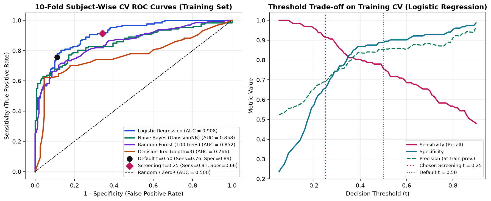

# SE309-50 · Dementia Screening from Tabular Brain-Imaging Features

**Course:** SE309 AI and Data Science for Innovation in Health Science · Fall 2026–27  
**Topic code:** SE309-50 · **Working as:** Group (5 members)  
**Agreed extra feature(s):** Scope for a group of 5 — (1) Core + subject-wise split extension, (2) Longitudinal conversion prediction on OASIS-2, (3) External validation between OASIS-1 and OASIS-2, (4) Model reliance (MMSE ablation, sex/age subgroups, feature importance), (5) Screening model selection, ROC threshold tuning, and prevalence-adjusted precision analysis (Member 5).

## Members

| Name | Student no. | GitHub username |
|---|---|---|
| Furkan Selami Düzgün | 220201815 | @furkanduzgun52 |
| Burak Emre Başar | 220201068 | @aLpwren |
| Alperen Keskin | 230201094 | *(pending in sheet)* |
| Yaman Balcı | 220201081 | *(pending in sheet)* |
| Fatih Osman Darılmaz | 220201083 | @darilmaz-cmd |

## What the project does

This project investigates dementia screening from tabular clinical, demographic, and structural MRI brain-volume features (`Age`, `M/F`, `EDUC`, `SES`, `MMSE`, `eTIV`, `nWBV`, `ASF`) using the public OASIS-1 and OASIS-2 cohorts without leaking the diagnostic `CDR` score. The intended users are clinicians or screening coordinators deciding which older adults should be referred for a specialist dementia evaluation, not as a standalone diagnostic tool. At the Week 10 interim milestone, the repository delivers the leakage-free subject-wise split and preparation pipeline (Part 1 foundation) alongside **Part 5 (Member 5)**: comparing classifiers via 10-fold subject-wise cross-validation against the ZeroR baseline, choosing a high-sensitivity screening threshold (`t = 0.25`) on training data only, computing precision at dataset (`44.8%`) vs general older population (`10%`) prevalence, and evaluating once on the held-out test set.

## How to install and run

### Python / Colab
1. Accept the OASIS Data Use Agreement at https://sites.wustl.edu/oasisbrains/ and download the tabular demographic/clinical `.xlsx` files for OASIS-1 and OASIS-2 into `data/`.
2. Open `notebooks/project.ipynb` in Google Colab (**File → Open notebook → GitHub**, paste `https://github.com/furkanduzgun52/SE309-Brain-Imaging`) or run locally with Python 3 (`pandas`, `scikit-learn`, `matplotlib`, `openpyxl`).
3. Run **Runtime → Restart and run all**.

## Example output



*10-fold subject-wise CV (`StratifiedGroupKFold`, `n = 279` visits across `112` training subjects): Logistic Regression achieves `AUC = 0.908` (vs `ZeroR 0.500`). Lowering the screening threshold to `t = 0.25` achieves `90.0%` sensitivity (`36/40` demented visits detected) on the locked held-out test set (`n = 94` visits, `38` unseen subjects).*

## Data

| Dataset | Source (link) | Size | Licence / terms of use |
|---|---|---|---|
| OASIS-1 (Cross-Sectional) | https://sites.wustl.edu/oasisbrains/home/oasis-1/ | 436 sessions × 12 columns (235 with CDR) | OASIS Data Use Agreement (July 2025 terms, non-commercial academic use) |
| OASIS-2 (Longitudinal) | https://sites.wustl.edu/oasisbrains/home/oasis-2/ | 373 visits × 15 columns (150 subjects) | OASIS Data Use Agreement (July 2025 terms, non-commercial academic use) |

> Only public or properly released data is used. Per the OASIS Data Use Agreement, raw `.xlsx` files are not redistributed publicly in this repository (`data/*.xlsx` is gitignored); each collaborator obtains access individually from OASIS.

A short **data note** (who, why, when/where, label, missingness, impossible values, timing, consent) is in Section 2 of [`notebooks/project.ipynb`](notebooks/project.ipynb) and in [`reports/interim_report.pdf`](reports/interim_report.pdf).

## Folder structure

```
├── README.md
├── .gitignore
├── data/                 # local OASIS-1 & OASIS-2 tabular .xlsx files (gitignored per OASIS DUA)
├── images/               # generated EDA, ROC, and confusion-matrix figures
├── notebooks/
│   └── project.ipynb     # main runnable notebook (SE309 template)
├── reports/
│   └── interim_report.pdf
└── video.md              # link to the presentation video (added at final)
```

## Who did what

| Member | Main responsibilities | Main files / parts |
|---|---|---|
| @darilmaz-cmd | Shared Part 1 prep & subject-wise split foundation; **Part 5** (10-fold CV comparison, ROC threshold tuning, prevalence precision analysis, held-out test evaluation), README, Interim Report | `notebooks/project.ipynb` (§1–§11), `README.md`, `reports/interim_report.pdf`, `images/*` |
| Yaman Balcı | Assigned to **Part 4** (MMSE ablation, sex/age subgroup breakdown, feature importance) — planned for final | Planned: Part 4 |
| @furkanduzgun52 | Repository creation; assigned to **Part 1/2/3** — planned for final | Repo setup |
| @aLpwren | Assigned to **Part 1/2/3** — planned for final | Planned: Part 1/2/3 |
| Alperen Keskin | Assigned to **Part 1/2/3** — planned for final | Planned: Part 1/2/3 |

Every member commits their own work from their own GitHub account.

## External code, libraries and AI tools

| What | Used for | Where |
|---|---|---|
| `pandas`, `numpy`, `openpyxl` | Loading OASIS Excel files, tabular data processing, prevalence math | `notebooks/project.ipynb` (§3–§7) |
| `scikit-learn` | Subject-wise splitting, pipelines, median imputation, scaling, classifiers, metrics | `notebooks/project.ipynb` (§5–§7) |
| `matplotlib` | EDA histograms, ROC curves, threshold trade-offs, test confusion matrices | `notebooks/project.ipynb` (§4, §7), `images/*` |
| `fpdf2` | Interim Report PDF generation | `reports/interim_report.pdf` |
| AI coding assistant (Antigravity / Gemini) | Structuring notebook cells, debugging pipelines, drafting report text verified against real outputs | `notebooks/project.ipynb`, `README.md`, `reports/interim_report.pdf` |

## Reports and video

- Interim report (Week 10): [`reports/interim_report.pdf`](reports/interim_report.pdf)
- Final report: *to be added at final submission* (`reports/final_report.pdf`)
- Presentation video: *to be added at final submission* (`video.md`)
